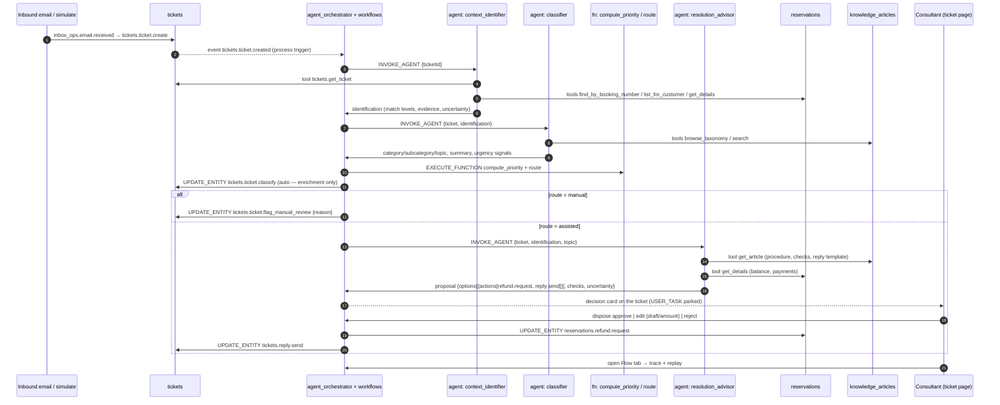
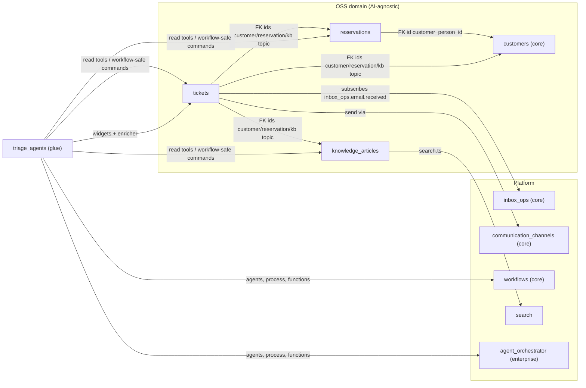

# Travel Ticket Triage Demo — Umbrella Spec

> **Status:** Draft · **Date:** 2026-10-12 · **Scope:** OSS app modules + one enterprise glue module + one Agent Orchestrator platform delta
> **Source scenarios:** [`.ai/docs/demo-orchestrator.md`](../docs/demo-orchestrator.md) (Acme 1 + Acme 2 — "overpayment refund with multi-source context") and [`.ai/docs/case_ai_triage_ticketow_otrs.md`](../docs/case_ai_triage_ticketow_otrs.md) (AI triage of OTRS tickets, examples 1–4).

## TLDR

**Key Points:**
- Build a demo-able, end-to-end **AI ticket triage** for a travel agency on top of the existing Agent Orchestrator (AO) + workflows engine. A new ticket triggers a process. Agents gather context from **CRM (customers + reservations)**, the **ticket thread** and the **Knowledge Base**. They identify the customer and reservation, classify the ticket and compute priority (departure in 3 days → high). They write a summary and a recommendation ("verify the overpayment and request a refund"), plus a reply draft based on the KB process. A consultant then **approves / edits / rejects** the proposal, and the whole flow is traceable and replayable.
- The work is split into **five independently owned units**. Each has one responsibility; domain modules know nothing about AI.

**Module map:**

| # | Unit | Kind | Responsibility | Spec |
|---|------|------|----------------|------|
| 1 | `reservations` | app module (OSS) | Travel CRM extension: reservations, payments, balance/overpayment, refund requests. Customer profiles and contact history reuse core `customers`. | [`2026-10-12-reservations-module.md`](2026-10-12-reservations-module.md) |
| 2 | `tickets` | app module (OSS) | OTRS-like helpdesk: tickets from inbound email, article thread, queue/status/priority, classification fields, reply drafts, sending replies. | [`2026-10-12-tickets-module.md`](2026-10-12-tickets-module.md) |
| 3 | `knowledge_articles` | app module (OSS) | Knowledge Base of service processes: category → subcategory → topic, procedures, reply templates, recommended actions, search. | [`2026-10-12-knowledge-articles-module.md`](2026-10-12-knowledge-articles-module.md) |
| 4 | `triage_agents` | app module (needs enterprise AO) | **Glue only**: agents, deterministic priority/routing functions, the triage process/workflow definition, triage projection, and UI widgets injected into `tickets`. | [`enterprise/2026-10-12-triage-agents-module.md`](enterprise/2026-10-12-triage-agents-module.md) |
| 5 | AO platform delta | enterprise package change | Generic capabilities the demo exposes but AO lacks: **proposal execution** after approval, an **evidence envelope**, a **scripted LLM provider**, a **process-level flow trace**, **replay** (playback + process re-run), and an **embeddable proposal decision card** with long-text editing and a **citations panel**. | [`enterprise/agent-orchestrator/2026-10-12-process-flow-trace-replay-and-embeddable-decision-card.md`](enterprise/agent-orchestrator/2026-10-12-process-flow-trace-replay-and-embeddable-decision-card.md) |

**Concerns:**
- Units 1–3 are deliberately AI-agnostic: a human can classify, reply and request a refund without any agent. AI is plugged in only by unit 4 through events, read tools, workflow-safe commands and widget injection. This is what makes the closing line of the demo true: *"the same skeleton works for Acme 1 and Acme 2 — only the sources and process content differ"*.
- Unit 4 depends on enterprise AO. It is enabled under the same flags as `agent_examples` (`OM_ENABLE_ENTERPRISE_MODULES` + `OM_ENABLE_ENTERPRISE_MODULES_AGENTS`).

## Decisions (resolved 2026-10-12)

- **D1 — Placement:** units 1–4 are `@app` modules in `apps/mercato/src/modules/`.
- **D2 — OTRS:** native `tickets` module fed from `inbox_ops.email.received`, plus a "simulate inbound email" endpoint. A real OTRS connector is a later phase.
- **D3 — Agent runtime:** **code agents** (`defineAgent` in `ai-agents.ts`). File (OpenCode) agents cannot `@ref` `defineAiTool`s from `apps/**` modules: the standalone MCP server loads the compiled `ai-tools.generated.mjs` with plain Node ESM, cannot import app-module TS, and one failed import drops *all* tools (`agent_orchestrator/AGENTS.md`, Never rules). *Open:* switch to OpenCode only if the tools move to a package or the MCP loader is fixed.
- **D4 — Sending replies:** the configured channel, or a `simulated` delivery when none is configured.
- **D5 — External nodes (LangGraph / DeepAgents):** **out of scope.** No support is added; the demo's closing does not show it.
- **D6 — Language:** **everything in English**: seed content (KB, emails, drafts, agent output, priority reasons) and UI. Locale files carry `en`; other locales follow the repo's normal i18n coverage rules.
- **D7 — KB grounding must be visible.** The demo must *prove* that the agent follows the KB instructions, not just mention the KB. See **KB grounding** below. Importing Acme 1's own documents stays out of scope.

## Overview

The demo targets two prospects with one skeleton:

- **Acme 2 (CRM + OTRS + KB):** literal fit. The sources are reservations/customers, tickets and the KB.
- **Acme 1 (their documents and agents):** the same orchestration, approval and trace. Only the sources (KB content, tools) differ.

The **orchestration, approval and trace** are the product being demonstrated. The domain modules are realistic but minimal fixtures that make those capabilities visible.

## Problem Statement

1. **No domain to orchestrate.** The repo has no ticket/helpdesk, reservation or knowledge-base domain. Core `customers` has no reservations. `inbox_ops` has no queue, status or priority. `documents` disables search and needs a collab sidecar.
2. **No read tools.** Agents have no tools for a customer-by-email lookup, reservations with departure dates, a payment balance, a ticket thread or KB lookup.
3. **No composite proposal.** No agent produces a triage block (customer, reservation, category, priority, summary) together with a proposal of several customer-facing actions (refund + reply).
4. **AO gaps:**
   - The trace is **per agent run**; there is no end-to-end flow view of trigger → steps → runs → disposition → effectors.
   - Replay is only a live **rerun of one run**.
   - There is no proposal card that can be embedded on another module's detail page, and long-text (reply draft) editing is not first-class.

## Proposed Solution

### Scenario → capability matrix

| Scenario | Identification | Classification (KB topic) | Priority | Route | Proposal (human approval) |
|---|---|---|---|---|---|
| **Orchestrator demo / OTRS ex. 1** — overpayment refund ABC123, departure in 3 days | booking number found, owner email matches → `confirmed` | Payments / Refunds / Overpayment refund | **high — departure in 3 days** | assisted | `reservations.refund.request{amount, IBAN}` + `tickets.reply.send{draft}` |
| **Ex. 2a** — payment confirmation, payment booked | email → single reservation | Payments / Incoming payments / Payment confirmation | by departure | assisted | `tickets.ticket.transition{resolved}` + `tickets.reply.send{confirmation}` |
| **Ex. 2b** — payment confirmation, payment NOT booked | as above | as above | by departure | **manual** — `payment_not_visible` discrepancy | none (no proposal; ticket flagged with the reason) |
| **Ex. 3** — quiet room wish | email → reservation inferred from hotel/date | Booking / Special requests / Room preference | by departure | **manual** — topic is `manual_only` | none |
| **Ex. 4** — complaint | identified | Complaints / Service / Hotel service complaint | ≥ normal | **manual** — moved to the `complaints` queue | none |
| **Uncertainty** — customer has 2 reservations, no hint in the text | candidates listed | classified | by nearest departure | **manual** — `reservation_ambiguous` | none |

### End-to-end flow

### Design decisions

| Decision | Rationale |
|---|---|
| Domain modules have **zero AI knowledge**; AI lives in `triage_agents` | Single responsibility, and a human-only workflow still works. The same domain can be re-orchestrated for Acme 1 without touching it. |
| Classification is auto-applied; customer-facing actions always need approval | Matches "Agent enriches the case before the consultant opens the ticket" and "No action on the customer without a human". Classification is reversible (undoable command) and non-customer-facing. |
| Priority and routing are **deterministic functions**, not LLM output | Demo trust: "high — departure in 3 days" must be reproducible and explainable. The LLM contributes only an `urgencySignal` that can raise the level by one step. |
| Three sequential agents rather than one mega-agent | Each step is a visible node in the process/trace (Kroki 2–4 of the demo). They can be evaluated separately, and failures are localised. |
| Refund = **request** (`reservations.refund.request`), not a money movement | "Request refund" means *order* a refund to finance. No payment-gateway coupling, and it is safe in a demo. |
| AO gaps solved **in AO** (generic), not in `triage_agents` | Flow trace, replay and the embeddable decision card are platform features that every AO customer needs. |

### Alternatives considered

| Alternative | Why rejected |
|---|---|
| Model tickets on top of `inbox_ops` proposals | `inbox_ops` is an email-to-action extractor with no queue/status/priority/assignee. Bending it would break its contract. We *consume* its `email.received` event instead (same pattern as `warranty_claims`). |
| Reservations as `sales_orders` | Heavy coupling to catalog, channels and documents for a demo. Departure date, hotel and travellers are not order concepts. Reconsider for a production travel vertical. |
| KB on the `documents` package | Per-record sharing disables search, and it needs a Yjs collab sidecar. The KB must be searchable by agents. |
| One agent with `subAgents` fan-out | It collapses the flow into one run and hides the steps from the process view. It stays a valid optimisation (identifier ∥ KB prefetch) and is recorded as a follow-up. |

### KB grounding (D7)

Showing the agent "used the KB" in the trace is not enough. The demo must show that **the KB decides what the agent does**. That rests on three mechanisms:

1. **Structured, citable articles** (`knowledge_articles`): numbered `procedure_steps` (`S1`, `S2`, …), keyed `required_checks`, `recommended_actions`, `automation_level` and a `reply_template`. Every article version is immutable once published (`key@version`).
2. **Mandatory citations** (`triage_agents`): every check, action and draft paragraph in the proposal cites `articleKey@version` + step ids / check keys. The schema rejects a proposal whose actions are not covered by the article's `recommended_actions`. An AO grounding guardrail (cite-or-abstain) verifies that the cited steps exist in the retrieved version; on failure → `guardrailBlocked` → manual review.
3. **Visible on screen** (AO decision card citations panel + Flow tab): the consultant sees *which* article, *which* steps and checks, and *which* parts of the draft came from the template. The **edit-the-KB → re-run** moment proves causality.

## Architecture

### Module dependency graph

`tickets` holds FK **ids** only (no ORM relations) to `customers`, `reservations` and `knowledge_articles`. It resolves labels through soft-optional reads (`tryResolve`), so `tickets` works with the other two disabled.

### Cross-module contract summary

| Owner | Surface | Consumed by |
|---|---|---|
| `tickets` | events `tickets.ticket.created`, `tickets.ticket.classified`, `tickets.article.received`, `tickets.reply.sent`, `tickets.ticket.status_changed` | `triage_agents` (process trigger, projection) |
| `tickets` | workflow-safe commands `tickets.ticket.classify`, `tickets.ticket.flag_manual_review`, `tickets.ticket.transition`, `tickets.reply_draft.save`, `tickets.reply.send` | AO effectors |
| `tickets` | read tools `tickets.get_ticket`, `tickets.list_tickets` | agents |
| `tickets` | injection spots `detail:tickets.ticket:header`, `detail:tickets.ticket:sidebar`, `detail:tickets.ticket:tabs`, `data-table:tickets.ticket:columns`, `crud-form:tickets.ticket_reply:fields` | `triage_agents` widgets |
| `reservations` | read tools `reservations.find_by_booking_number`, `reservations.list_for_customer`, `reservations.get_details` | agents |
| `reservations` | workflow-safe command `reservations.refund.request` | AO effector |
| `knowledge_articles` | read tools `knowledge_articles.browse_taxonomy`, `knowledge_articles.search`, `knowledge_articles.get_article` | agents |
| `knowledge_articles` | search entity `knowledge_articles:knowledge_article` | `search_query` |
| `triage_agents` | agents `triage_agents.context_identifier`, `triage_agents.classifier`, `triage_agents.resolution_advisor`; functions `triage_agents.compute_priority`, `triage_agents.route`; process `triage_agents.ticket_triage` | AO, workflows |
| AO (delta) | `GET /api/agent_orchestrator/executions/:id/flow`, `GET /api/agent_orchestrator/executions?subjectType=&subjectId=`, `POST /api/agent_orchestrator/executions/:id/rerun`, components `ProcessFlowTrace`, `ProposalDecisionCard` | `triage_agents` widgets |

## Data Models

Defined in the per-module specs. Summary of the new tables:

| Module | Tables |
|---|---|
| `reservations` | `reservations`, `reservation_payments`, `reservation_refunds` |
| `tickets` | `tickets`, `ticket_articles`, `ticket_reply_drafts`, `ticket_sequences` |
| `knowledge_articles` | `knowledge_categories`, `knowledge_articles`, `knowledge_article_versions` (immutable published snapshots) |
| `triage_agents` | `ticket_triages` (projection) |
| AO delta | additive columns only: `rerun_of_execution_id` on the process instance projection (see the AO delta spec) |

## API Contracts

The full contracts live in the per-module specs. Demo-specific:

- `POST /api/tickets/intake/simulate`, feature `tickets.intake.simulate`. It creates a ticket from `{ fromEmail, fromName?, subject, body, receivedAt? }` exactly as the inbound-email path would.
- CLI: `yarn mercato triage_agents demo:reset` re-anchors seeded reservation dates relative to *today* (so "departure in 3 days" stays true). CLI: `yarn mercato triage_agents demo:send <scenario>` posts one of the seeded scenario emails.

## Demo Seed Data (cross-module, `seedExamples` only)

| Persona | Email | CRM state | Scenario email |
|---|---|---|---|
| Anna Carter | `anna.carter@example.com` | ABC123, Crete, departure **today + 3**, total 2,400 EUR, paid 2,750 EUR → **overpayment 350 EUR** | "Please refund the overpayment on booking ABC123 to my account DE89 3704 0044 0532 0130 00." |
| Peter Brooks | `peter.brooks@example.com` | one reservation XYZ789, departure +40, payment **booked** | "Attached is the confirmation of my bank transfer." |
| Maria Lopez | `maria.lopez@example.com` | one reservation, departure +12, payment **not booked** | "I am sending the payment confirmation for my trip." |
| Emma Wilson | `emma.wilson@example.com` | two reservations (Hotel Aurora, Rhodes +9; Hotel Sol, Mallorca +120) | "Could we get a room in a quiet part of Hotel Aurora?" |
| Tom Walker | `tom.walker@example.com` | one completed reservation | complaint about a dirty room and broken air-conditioning |
| John Miller | `john.miller@example.com` | two reservations, no hint in the text | "Can I change the date of my trip?" → ambiguous |

Each module seeds its own data in its own `setup.ts` `seedExamples`. `reservations` seeds customers' people through the `customers` commands (FK id), not through direct ORM access. `triage_agents` seeds only the process definition. Scenario emails are sent on demand (CLI or UI button), not seeded, so the trigger is visible live.

## Demo Script → implementation mapping

| Demo step | What the audience sees | Delivered by |
|---|---|---|
| Setup | Three sources (CRM, ticket queue, KB) + Processes view | `reservations`, `tickets`, `knowledge_articles`, AO Processes |
| 1 Start | "Send demo scenario" → new ticket in the queue with AI status `Analyzing…` | `tickets` simulate + `triage_agents` column widget |
| 2 Multi-source | Flow tab: identifier and classifier runs with each tool call (CRM, ticket, KB) | AO delta `ProcessFlowTrace` |
| 3 Identification & classification | Ticket header card: Customer ✓ · ABC123 · Payments / Refunds · **high – departure in 3 days** · summary · uncertainty chips | `triage_agents` summary card |
| 4 Execution with knowledge | Recommendation "Verify the overpayment and request a refund" + draft. **"Based on knowledge base"** panel: article path + version, the procedure steps and checks the agent followed (each check ✓/✗ with CRM evidence), the template-derived parts of the draft highlighted; the `get_article` call is visible in the Flow tab | `resolution_advisor` + KB + AO decision card citations |
| 5 Human approval | Decision card above the composer (the summary card's "Review proposal" jumps to it): refund 350 EUR, masked IBAN (reveal only with `reservations.refund.manage`), editable draft; Approve & send / Edit / Reject | AO delta `ProposalDecisionCard` in the `triage-decision-card` widget |
| 6 Flow tracking | "AI triage flow" section on the ticket: full flow incl. disposition + effector results; **Playback**, attempt selector + **Compare**, **Re-run triage** | AO delta `ProcessFlowTrace` in the `triage-flow-tab` widget + replay |
| **KB-driven behaviour (D7)** | Live: open the *Overpayment refund* article, add the rule "Refunds above 300 EUR require a finance review — do not promise a refund date" (a new required check + a template sentence), publish v4, **Re-run triage** on ABC123 (summary card or flow tab; with the v3 proposal still pending it asks to reject and re-run — the v3 proposal is superseded, the ticket is not flagged) → the new check appears, the draft changes, and the citation shows v4; the flow's attempt selector / **Compare** shows v3 vs v4. For a scripted rehearsal the edit must add step `S6` with `checkKey: finance_review` and the required check `finance_review` (fixture `05-overpayment-refund-finance-review`). Optional second edit: switch the article to `manual_only` → the re-run routes to manual review with the article's reason | `knowledge_articles` editor + `triage_agents` re-run (supersede) + flow compare |
| Closing | Process editor: swap tools/KB = Acme 1 | AO process definitions |
| **Consultant view** (optional) | Log in as the helpdesk consultant (`yarn mercato triage_agents demo:consultant --tenant <id> --org <id>` → credentials in `apps/mercato/.mercato/demo-consultant.json`, default `consultant@acme.example`). The same ticket shows the summary card and the decision card (facts, KB citations, Approve & send / Edit / Reject) — but no "AI triage flow" section, no Open in Caseload / Open flow / Re-run, no demo email simulator and no Agents sidebar group. Their entry point is the Helpdesk sidebar item **Awaiting decision** (live count badge) which opens the ticket queue pre-filtered to tickets whose AI proposal is pending; the queue's **Awaiting decision** preset toggles the same filter, and approving on the ticket page drops the count. Message: the helpdesk sees the decision basis, the AI team keeps the internals | `triage_agents` `support_consultant` role + awaiting-decision menu/preset/interceptor + AO `decision_context` |

## Implementation Plan (cross-module phasing)

Each phase leaves the app working and demoable.

| Phase | Deliverable | Units | Depends on |
|---|---|---|---|
| **1 — Domain** | Reservations (with balance), KB taxonomy and articles with search, tickets with intake, thread, manual classify/reply. Seeds. | 1, 2, 3 (parallel) | — |
| **2 — Read tools + commands** | AI read tools in 1–3; workflow-safe command registration (`workflows.ts`) | 1, 2, 3 | 1 |
| **3 — AO runtime delta** | Proposal execution function, evidence envelope, scripted LLM provider | 5 | — |
| **3b — Agents + process** | 3 agents, 2 functions, process definition, projection, summary card + queue column | 4 | 2, 3 |
| **4 — Approval + flow trace** | AO embeddable decision card, flow API + component, flow tab, decision card widget | 5 → 4 | 3 |
| **5 — Replay + extras** | Playback, process re-run, KB-edit → re-run demo moment, demo CLI, golden evals | 5, 4 | 4 |

## Testing Strategy

- Unit: priority/routing functions (table-driven over all 6 personas); IBAN validation; refund amount ≤ overpayment; ticket thread matching (`In-Reply-To`, `[TCK-…]` subject token).
- Integration (Playwright, self-contained fixtures, per `.ai/qa/AGENTS.md`): each module's CRUD/API paths, plus the `triage_agents` E2E with a **stubbed LLM provider** (deterministic agent outputs) covering all 6 scenarios. The happy path continues through approve-with-edit → refund requested + outbound article recorded.
- A live-LLM smoke run is manual only (not in CI).

## Risks & Impact Review

| Risk | Severity | Area | Mitigation | Residual |
|---|---|---|---|---|
| LLM misidentifies the reservation during a live demo | High | demo credibility | Identification is tool-backed and verified (`booking number ∧ owner email`); a stubbed-provider rehearsal mode; uncertainty is shown, never hidden | Low |
| "Departure in 3 days" drifts as seed ages | Medium | demo | `demo:reset` CLI re-anchors dates; priority is computed at triage time from `departure_date` | Low |
| An agent proposes a refund above the overpayment, or to the wrong account | High | customer impact | Command-level validation (amount ≤ overpayment, IBAN checksum); human approval is mandatory; auto-approve is disabled for this process | Low |
| An email is actually sent to a real customer in the demo | High | external | Demo data uses `example.com`; the `simulated` delivery fallback; sending requires approval | Low |
| `triage_agents` couples to three modules | Medium | architecture | Only through events, read tools, workflow-safe commands and injection spots; no ORM imports | Low |
| AO delta scope creep (flow trace, replay) | Medium | schedule | Phase 4/5 split; playback is client-side over recorded data (no new runtime) | Medium |

## Final Compliance Report

| Rule | Status |
|---|---|
| Plural snake_case module ids (`reservations`, `tickets`, `knowledge_articles`, `triage_agents`) | ✅ |
| No cross-module ORM relations (FK ids + snapshots) | ✅ |
| Tenant/org scoping on every entity | ✅ (per-module specs) |
| Encryption maps for PII / free text / bank account | ✅ (per-module specs) |
| Optimistic locking on user-editable entities | ✅ (`updated_at` everywhere) |
| Events `module.entity.action` singular / past tense | ✅ |
| AI agents read-only; writes only via proposal → disposition → command | ✅ |
| Enterprise-dependent scope in `.ai/specs/enterprise/` | ✅ (units 4, 5) |

## Changelog

- **2026-10-12** — Initial draft: module split, scenario matrix, contracts, phasing.
- **2026-10-12** — Resolved open questions (D1–D7): English-only content, no LangGraph/DeepAgents, code agents (OpenCode limitation documented), KB grounding section + KB-edit → re-run demo moment.
- **2026-10-12** — Code-research corrections: AO runtime delta (execution, evidence, scripted provider) is a prerequisite of the agents phase.
- **2026-10-13** — Demo Script steps 5–6 and the KB-edit moment updated for the shipped decision card / flow tab widgets and the supersede re-run.
- **2026-10-15** — Demo Script: optional "consultant view" step (`support_consultant` role, `demo:consultant` CLI).
- **2026-10-15** — Consultant view: "Awaiting decision" Helpdesk sidebar entry (count badge) + queue preset as the consultant's decision inbox (no Caseload needed).
