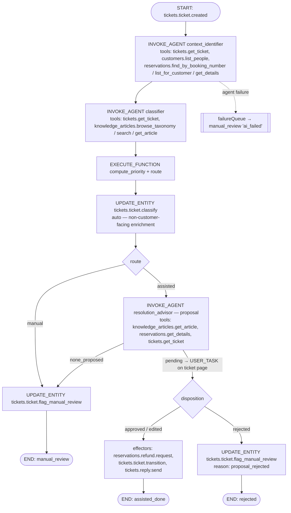

# Triage Agents Module (AI triage orchestration glue)

> **Status:** Draft · **Date:** 2026-10-12 · **Module:** `triage_agents` (`apps/mercato/src/modules/triage_agents`, `@app`, enabled only with `OM_ENABLE_ENTERPRISE_MODULES` + `OM_ENABLE_ENTERPRISE_MODULES_AGENTS`, like `agent_examples`)
> **Parent:** [`../2026-10-12-travel-ticket-triage-demo.md`](../2026-10-12-travel-ticket-triage-demo.md)
> **Depends on:** `tickets`, `reservations`, `knowledge_articles` (OSS app modules), `customers`, `workflows`, enterprise `agent_orchestrator` (+ [AO delta](agent-orchestrator/2026-10-12-process-flow-trace-replay-and-embeddable-decision-card.md) for Phases 4–5)

## TLDR

**Key Points:**
- The **only** module that knows about AI. It defines:
  - **3 agents**: `context_identifier`, `classifier`, `resolution_advisor`.
  - **2 deterministic workflow functions**: `compute_priority`, `route`.
  - **1 triggered process**: `triage_agents.ticket_triage`, started by `tickets.ticket.created`.
  - A **triage projection** (`ticket_triages`).
  - **UI widgets** injected into `tickets`: the AI summary card, the decision card, the Flow tab, the queue column/filter, and the scenario presets.
- It owns **no business data**. Every write goes through the domain modules' workflow-safe commands, executed as AO effectors after (auto- or human-) disposition.

**Scope:** agents + result schemas, functions, workflow definition JSON, process seed, projection + enricher, widgets, demo CLI, golden eval cases.

**Out of scope:** changes to the domain modules beyond their published contracts; AO platform features (flow API, replay, embeddable card), which are covered by the AO delta spec.

## Overview

The module implements demo Steps 1–6 as one **business process** in AO:



## Problem Statement

The AO has the machinery (event triggers → processes → `INVOKE_AGENT` → proposals → disposition → effectors, plus traces). Nothing assembles it for ticket triage: there are no agents, no priority/route policy, no process, no ticket-side UI that shows the result where the consultant works.

## Proposed Solution

### Design decisions

| Decision | Rationale |
|---|---|
| **Code agents** (`defineAgent` in `ai-agents.ts`) | File agents cannot `@ref` tools declared in `apps/**` (umbrella Q3). Code agents run in-process with the read-only tool loop, and every tool call lands in `AgentToolCall`/spans. |
| Three agents of different kinds: identifier = `researcher`, classifier = `researcher`, resolution advisor = `proposal` (`decision_maker`) | Only the last one proposes customer-facing actions. The first two inform, and their outputs are auto-applied by deterministic steps. |
| Priority and route are **functions** (`workflowFunction:triage_agents.*` in DI), not LLM output | Reproducible, unit-tested and explainable ("high – departure in 3 days"). The LLM only provides `urgencySignal`. |
| Classification applied with `source: 'workflow'` **without approval** | It is an internal, undoable enrichment ("the agent enriches the case before the consultant opens the ticket"). |
| Auto-approval **disabled** for `resolution_advisor` in this process (`onResult.autoApproveThreshold` omitted; the policy blocks `risk`) | "No action on the customer without a human." |
| `allowedActions` of `resolution_advisor` = `reservations.refund.request`, `tickets.ticket.transition`, `tickets.reply.send` | It is fail-closed: the agent cannot propose anything else even if the KB names it. |
| Tools rather than an AO `ContextModule` for multi-source reads | Demo Step 2 needs every source read **visible as a tool call** in the trace. A context bundle is resolved before the run and appears as one block. A `ContextModule` (KB retrieval) stays as an optional enrichment. |

## Agents (`ai-agents.ts`)

All agents: `moduleId: 'triage_agents'`, `loop.maxSteps ≤ 8`, English output for user-visible text, instructions in `lib/prompts/*.md` (sectioned like `warranty_claims.claims_assistant`). The rules **never guess**, **cite evidence**, and **list uncertainty explicitly** are in every prompt.

### `triage_agents.context_identifier` (researcher)
- **Input:** `{ ticketId }`
- **Tools:** `tickets.get_ticket`, `tickets.list_tickets`, `customers.list_people` (exact email), `reservations.find_by_booking_number`, `reservations.list_for_customer`, `reservations.get_details`
- **Procedure** (from the OTRS brief §1):
  1. Extract booking-number candidates from subject and body.
  2. If there is a number → `find_by_booking_number{senderEmail}`. Owner `match` → `confirmed`; `mismatch` → `identity_mismatch` (do NOT use that reservation).
  3. With no number → reservations by email. One → `single_reservation`. Several → infer from destination/hotel/date mentioned in the text (`inferred_from_content`, with the evidence quote), else `ambiguous` (list the candidates). None → `not_found`.
- **Result schema (zod):**
  ```ts
  {
    customer: { personId: string | null, match: 'confirmed' | 'email_only' | 'not_found' },
    reservation: { reservationId: string | null, bookingNumber: string | null,
                   match: 'explicit_number_verified' | 'single_reservation' | 'inferred_from_content'
                        | 'ambiguous' | 'identity_mismatch' | 'not_found',
                   candidates: { reservationId: string, bookingNumber: string, label: string }[],
                   departureDate: string | null, daysToDeparture: number | null },
    evidence: { source: 'ticket' | 'crm', quote: string }[],
    uncertainty: { code: string, message: string }[],
    confidence: number
  }
  ```

### `triage_agents.classifier` (researcher)
- **Input:** `{ ticketId, identification }`
- **Tools:** `tickets.get_ticket`, `knowledge_articles.browse_taxonomy`, `knowledge_articles.search`, `knowledge_articles.get_article`
- **Output:** `{ categoryKey, subcategoryKey, topicKey, topicVersion, summary (1–3 sentences, English, no full IBAN), intent, urgencySignal: 'none' | 'raise_one', urgencyEvidence?, automationLevel (copied from the article), extracted: { refundAmount?: number, bankAccount?: string, paymentDate?: string }, uncertainty[], confidence }`
- If no topic fits with confidence ≥ 0.5 → `topicKey: 'general.identification.unknown_booking'` plus an `uncertainty` entry.

### `triage_agents.resolution_advisor` (proposal, `agentType: 'decision_maker'`)
- **Input:** `{ ticketId, identification, classification }`
- **Tools:** `knowledge_articles.get_article`, `reservations.get_details`, `tickets.get_ticket`
- **Procedure:** load the article version; walk its `procedure_steps` in order; run each `required_checks` item against CRM data and record `checks[]` as passed/failed with evidence **and the step id it comes from**. If a blocking check fails → **no proposal** (`none_proposed`) with the reason (e.g. payment confirmation without a booked payment → `payment_not_visible`). Otherwise propose **one option** whose actions are a subset of the article's `recommended_actions`, plus a reply draft rendered from `reply_template` and the facts. The draft is split into segments, each tagged `template` (from the article) or `generated`.
- **Proposal payload** (AO `options[]` shape):
  ```json
  { "options": [{
      "id": "refund_and_reply", "label": "Verify the overpayment and request a refund", "confidence": 0.9,
      "actions": [
        { "type": "reservations.refund.request",
          "payload": { "reservationId": "…", "amount": 350.00, "currencyCode": "EUR",
                       "bankAccountNumber": "DE89370400440532013000",
                       "reason": "Overpayment per reservation balance", "relatedTicketId": "…",
                       "sourceType": "agent_proposal" } },
        { "type": "tickets.reply.send",
          "payload": { "ticketId": "…", "subject": "Re: …", "body": "Dear Ms Carter, …" },
          "citations": ["payments.refunds.overpayment_refund@3#S5"] }
      ]}],
    "rationale": "…", "checks": [{ "key": "overpayment_confirmed", "step": "S2", "passed": true, "evidence": "paid 2,750 > total 2,400" }],
    "citations": [{ "kind": "kb", "ref": "payments.refunds.overpayment_refund@3", "steps": ["S1","S2","S3","S4","S5"], "label": "Payments › Refunds › Overpayment refund (v3)" }],
    "draftSegments": [{ "source": "template", "ref": "payments.refunds.overpayment_refund@3#reply_template", "text": "…" }, { "source": "generated", "text": "…" }],
    "uncertainty": [] }
  ```
- **Facts** (`facts` in `defineAgent`, shown on the decision card): customer, booking number, departure, total / paid / overpayment, refund amount, masked IBAN, KB article.

## KB grounding (umbrella D7)

The goal is to make "the agent follows the KB" **verifiable**, not just claimed.

| Layer | Mechanism | Failure behaviour |
|---|---|---|
| Input | `resolution_advisor` must call `knowledge_articles.get_article` for the classified `topicKey`; the call (with `key@version`) is a visible node in the Flow tab | no article → `none_proposed` → manual (`kb_article_missing`) |
| Output schema | Every action and check carries `citations` (`key@version#S<n>` / `#check:<key>`); action types ⊆ the article's `recommended_actions`; the draft is split into `template` / `generated` segments | schema violation → run fails → `ai_failed` |
| Guardrail | AO grounding check (cite-or-abstain): the cited version exists, the cited step ids exist in it, and every `required_checks` key appears in `checks[]` | → `guardrailBlocked` → manual review (`kb_grounding_failed`) |
| Policy | `automation_level`, `priority_floor` and `target_queue_key` are read from the article by the deterministic functions, not by the LLM | n/a: deterministic |
| UI | The decision card citations panel resolves `key@version` against `knowledge_article_versions` (exactly the text the agent read) and links to the article with the step highlighted | — |
| Demo proof | Edit the article live → publish v4 → **Re-run triage** → the new check appears in `checks[]`, the draft contains the new template sentence, and the citation shows v4. Flow compare (AO delta C3) shows v3 vs v4 side by side | — |
| Regression | Golden eval cases assert the citation `key` and that the checks are covered | — |

## Deterministic functions (`di.ts` → `workflowFunction:<name>`)

### `triage_agents.compute_priority(args: { daysToDeparture, topicKey, priorityFloor, urgencySignal })`

| Rule (first match, then floor, then signal) | Priority | Reason (i18n key, English copy) |
|---|---|---|
| `daysToDeparture` ≤ 1 | urgent | "urgent – departure today/tomorrow" |
| `daysToDeparture` ≤ 3 | high | "high – departure in {n} days" |
| `daysToDeparture` ≤ 14 | normal | "normal – departure in {n} days" |
| otherwise / unknown | low | "low – departure in {n} days" / "no departure date" |
| apply the KB `priority_floor` (e.g. complaint ≥ normal) | max(current, floor) | "+ topic minimum" |
| `urgencySignal = raise_one` | +1 level (cap urgent) | "+ urgency stated in message" |

Returns `{ priority, priorityReason }`. Thresholds are a constant table in `lib/priorityPolicy.ts`, tested over all six personas.

### `triage_agents.route(args: { identification, classification })`
Returns `{ route: 'assisted' | 'manual', reasonCode?, reason?, targetQueueKey? }`:
- `customer.match = not_found` or `reservation.match ∈ {ambiguous, identity_mismatch, not_found}` → manual (`reservation_ambiguous` / `identity_mismatch` / `context_not_found`), with candidates listed in the reason.
- `automationLevel = manual_only` → manual (`topic_manual_only`, reason = the article's `manual_reason`, `targetQueueKey` from the article).
- any `uncertainty` with `blocking: true` or `classification.confidence < 0.6` → manual (`low_confidence`).
- else → assisted.

## Process & workflow definition

- `examples/ticket-triage-workflow.json` (modelled on AO `examples/refund-triage-workflow.json`): steps `start → identify → classify → policy → apply_classification → (manual_review | resolve) → (effectors | flag_rejected) → end`. Transitions use the outcome handles `approved`, `rejected`, `guardrailBlocked` and the `context.route` condition. `errorDirective: { mode: 'failureQueue' }` on the agent steps; the failure path flags manual review with `ai_failed`.
- `resolve` step: `INVOKE_AGENT resolution_advisor` with `review: { assignedToRoles: ['employee'], priority: '{{context.priority}}', deadline: { duration: 'PT4H' } }` and `signalConfig: agent_orchestrator.proposal.ready`.
- **Effectors:** the approved/edited option's actions run in order through AO's `executeProposal` path (action type → command id, re-checked against `allowedActions` ∩ workflow-safe catalogue right before execution). Order: `reservations.refund.request` → `tickets.ticket.transition` → `tickets.reply.send`. If one fails, the rest are skipped, the step fails into `failureQueue`, and the ticket is flagged `effector_failed`. Partial success is visible in the flow trace.
  > **Verify in Phase 3:** whether the materialized workflow can carry a multi-action option into `executeProposal` today, or only single `UPDATE_ENTITY {commandId}` steps reading `context.proposalPayload`. Fallback: the `EXECUTE_FUNCTION triage_agents.execute_approved_actions` function that calls `executeProposal`.
- **Process definition** seeded in `setup.ts` `seedExamples` (idempotent by key) through the AO processes command (soft-optional: skipped when AO is absent):
  - key `triage_agents.ticket_triage`
  - triggers:
    - `{ kind: 'event', eventPattern: 'tickets.ticket.created', contextMapping: [{ targetKey: 'ticketId', sourceExpression: 'payload.id' }] }`
    - `{ kind: 'manual' }` (used by "Re-run triage")
  - subject mapping `{ subjectType: 'tickets:ticket', subjectId: '{{context.ticketId}}', subjectLabel: '{{context.ticketNumber}}' }` (lets the AO delta find the flow by ticket).

## Data Models

### TicketTriage (`ticket_triages`): projection, rebuildable
- `id`, `organization_id`, `tenant_id`, `created_at`, `updated_at`
- `ticket_id` uuid (FK id, unique per org for the *current* triage); `process_execution_id` uuid; `workflow_instance_id` uuid
- `stage` enum `queued | identifying | classifying | awaiting_approval | applying | done | failed`
- `ai_mode` enum `assisted | manual_review` nullable ("AI status")
- `reason_code`, `reason` text nullable ("Reason")
- `identification` jsonb (match levels, candidates, evidence; no full PII: names/emails are referenced by id)
- `uncertainty` jsonb; `confidence` numeric
- `recommended_action_label` varchar nullable; `proposal_id` uuid nullable; `disposition` varchar nullable
- `draft_state` enum `none | prepared | sent | rejected`
- `run_ids` jsonb (`{ identifier, classifier, advisor }`); `attempt` int (re-runs)

It is written only by the `triage_agents.record_stage` function (called between steps) and by subscribers on AO proposal/disposition events. It can be rebuilt from the process instance via `yarn mercato triage_agents rebuild-projection`.

### Response enricher
On `GET /api/tickets/tickets` (list + detail), add `_triage: { aiMode, stage, reason, recommendedActionLabel, draftState, confidence, proposalId, executionId }`. It is batched by ticket ids.

## API Contracts (module-own, thin)
- `POST /api/triage_agents/tickets/:ticketId/rerun` → starts the process via its manual trigger (`attempt+1`). Feature `triage_agents.run`.
- `GET /api/triage_agents/scenarios` → scenario presets for the simulate dialog (the six umbrella emails). Feature `tickets.intake.simulate`.
- CLI: `yarn mercato triage_agents demo:reset` (re-anchors reservation dates, closes the demo tickets, clears projections), `demo:send <scenario|all>`, `rebuild-projection`.

## ACL
`triage_agents.view` (see AI cards; employee), `triage_agents.run` (re-run triage; employee), plus AO's `agent_orchestrator.proposals.dispose` and `trace.view` granted to the employee role in `setup.ts` (`defaultRoleFeatures`).

## UI (widgets in `widgets/injection/`)

| Widget | Spot | Content |
|---|---|---|
| `triage-summary-card` | `detail:tickets.ticket:header` | The target triage result block from the OTRS brief: Customer (✓ / ? with match level) · Reservation · Category path · Priority + reason · Summary · Recommended action · **AI status** (`StatusBadge`: assisted = info, manual_review = warning, failed = error) · Draft (prepared/sent) · uncertainty chips with tooltips. Live via `useAppEvent`. |
| `triage-decision-card` | `detail:tickets.ticket:composer` | AO `ProposalDecisionCard` (AO delta): facts, checks ✓/✗, **"Based on knowledge base" citations panel** (article path + version link, the cited procedure steps with their text, each check ✓/✗ with its step and CRM evidence, template-derived draft segments highlighted), actions with editable fields (amount, reply body as a long-text editor, IBAN read-only and masked with a reveal for `reservations.refund.manage`), buttons **Approve & send** / **Reject** (reason required); edits → `dispose{ edit }`. `Cmd/Ctrl+Enter` approve, Escape cancel. |
| `triage-flow-tab` | `detail:tickets.ticket:tabs` | AO `ProcessFlowTrace` for `subjectType=tickets:ticket&subjectId=:id` with an attempt selector, **Playback** and **Re-run triage** buttons. |
| `triage-queue-column` | `data-table:tickets.ticket:columns` + `:filters` | the "AI" column (status badge + recommended action), filter "AI status". |
| `triage-scenario-presets` | `data-table:tickets.ticket:toolbar` | "Send demo scenario" → simulate endpoint with a preset. |

All strings are in `i18n/en.json`; DS tokens only.

## Evals (Phase 5)
Six golden cases (one per persona) seeded as AO eval cases for the three agents, with deterministic assertions: reservation match level, topic key, route, action types. They are the regression set for the demo and the "Acme 1 swap" story.

## Implementation Plan

### Phase 3 — Agents + process (after domain Phase 2)
1. Module skeleton, `modules.ts` registration under the enterprise flags, `acl.ts`, `setup.ts`.
2. `lib/priorityPolicy.ts` + `lib/routePolicy.ts` + DI functions (unit tests over the personas).
3. Three agents + prompts + result schemas; Playground sample inputs.
4. Workflow JSON + process seed (event + manual trigger, subject mapping); verify the effector mechanism (see the note above).
5. `ticket_triages` entity + migration, `record_stage` function, subscribers, enricher.
6. `triage-summary-card` + queue column; scenario presets + simulate.

### Phase 4 — Approval + flow (after AO delta Phase A/B)
1. `triage-decision-card` on top of `ProposalDecisionCard`.
2. `triage-flow-tab` on top of `ProcessFlowTrace`.

### Phase 5 — Replay + polish
1. Re-run endpoint + button; Playback wiring (AO delta Phase C).
2. Demo CLI, golden eval cases, rehearsal mode with the stubbed provider.
3. KB-edit → re-run demo moment rehearsed end to end (edit article → publish v4 → re-run → new check + changed draft + v4 citation).

### Testing
- Unit: the priority and route tables; the result schemas reject over-long summaries and full IBANs in the summary.
- Integration (stubbed LLM provider returning recorded outputs per scenario):
  - Scenario 1: classify applied → proposal pending → approve-with-edit → refund `requested` (350 EUR) + outbound article `simulated` + projection `done/assisted`.
  - Scenario 2a: transition to `resolved` + reply.
  - Scenarios 2b / 3 / 4 / ambiguous: no proposal; ticket `needs_manual_review` with the expected reason code; the complaint is in the `complaints` queue.
  - Reject path → flagged `proposal_rejected`, nothing sent.
  - Agent failure → `ai_failed`.
  - The `allowedActions` violation (a stub proposes `customers.update_deal_stage`) is dropped and the step fails closed.

## Risks & Impact Review

| Risk | Severity | Mitigation | Residual |
|---|---|---|---|
| The LLM hallucinates a booking number or customer | High | Identification is valid only through tool results; the schema requires `evidence`; the route function forces manual on any non-verified match | Low |
| Full IBAN / PII ends up in summary or traces | High | The summary schema rejects IBAN patterns; AO tool-call summaries are redacted and payloads offloaded; IBAN masked in the UI | Medium |
| The effector chain partially executes (refund requested, reply failed) | Medium | Ordered execution, stop on first failure, flagged `effector_failed`, visible in the flow; the refund command is undoable | Low |
| A re-run creates a second proposal while the first is pending | Medium | The re-run endpoint rejects while `stage = awaiting_approval` unless the old proposal is rejected first | Low |
| A process trigger fires for tickets created by the re-run or by migration | Low | Trigger `filterConditions`: `payload.channel != 'api_import'`; manual trigger for re-runs | Low |
| Enterprise flag off → the module is disabled; domain modules unaffected | — | By design; domain modules never import this module | — |

## Final Compliance Report
Module id plural ✅ · no business data / FK ids only ✅ · writes only via workflow-safe commands after disposition ✅ · agents read-only ✅ · `allowedActions` fail-closed ✅ · scoping in projection and enricher ✅ · i18n / DS tokens ✅ · enterprise-dependent → enterprise spec dir ✅ · soft-optional AO seed ✅

## Changelog
- **2026-10-12** — Initial draft.
- **2026-10-12** — KB grounding section (citations, guardrail, draft segments, demo proof); English output; external-node stub removed.
