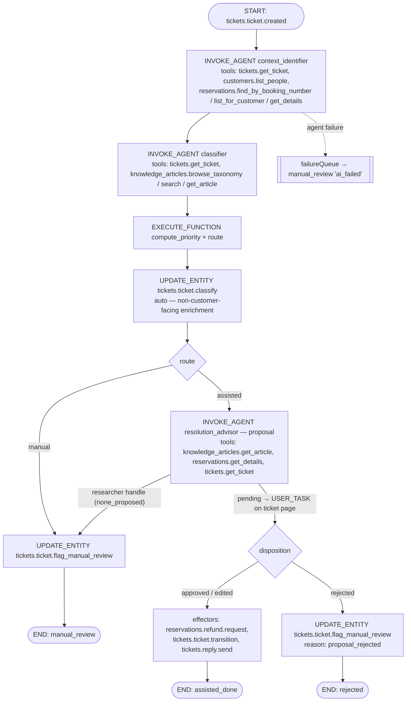

# Triage Agents Module (AI triage orchestration glue)

> **Status:** In progress (Phase 4 implemented — see Implementation Notes) · **Date:** 2026-10-12 · **Module:** `triage_agents` (`apps/mercato/src/modules/triage_agents`, `@app`, enabled only with `OM_ENABLE_ENTERPRISE_MODULES` + `OM_ENABLE_ENTERPRISE_MODULES_AGENTS`, like `agent_examples`)
> **Parent:** [`../2026-10-12-travel-ticket-triage-demo.md`](../2026-10-12-travel-ticket-triage-demo.md)
> **Depends on:** `tickets`, `reservations`, `knowledge_articles` (OSS app modules), `customers`, `workflows`, enterprise `agent_orchestrator` (+ [AO delta](agent-orchestrator/2026-10-12-process-flow-trace-replay-and-embeddable-decision-card.md): §E–G before Phase 3, §A–C for Phases 4–5)

## TLDR

**Key Points:**
- The **only** module that knows about AI. It defines:
  - **3 agents**: `context_identifier`, `classifier`, `resolution_advisor`.
  - **2 deterministic workflow functions**: `compute_priority`, `route`.
  - **1 triggered process**: `triage_agents.ticket_triage`, started by `tickets.ticket.created`.
  - A **triage projection** (`ticket_triages`).
  - **UI widgets** injected into `tickets`: the AI summary card, the decision card, the Flow tab, the queue column/filter, and the scenario presets.
- It owns **no business data**. Every write goes through the domain modules' workflow-safe commands, executed as AO effectors after (auto- or human-) disposition.

**Scope:** agents + result schemas, functions, workflow definition JSON, process seed, projection + enricher, widgets, demo CLI, golden eval cases.

**Out of scope:** changes to the domain modules beyond their published contracts; AO platform features (flow API, replay, embeddable card), which are covered by the AO delta spec.

## Overview

The module implements demo Steps 1–6 as one **business process** in AO:



## Problem Statement

The AO has the machinery (event triggers → processes → `INVOKE_AGENT` → proposals → disposition → effectors, plus traces). Nothing assembles it for ticket triage: there are no agents, no priority/route policy, no process, no ticket-side UI that shows the result where the consultant works.

## Proposed Solution

### Design decisions

| Decision | Rationale |
|---|---|
| **Code agents** (`defineAgent` in `ai-agents.ts`) | File agents cannot `@ref` tools declared in `apps/**` (umbrella Q3). Code agents run in-process with the read-only tool loop, and every tool call lands in `AgentToolCall`/spans. |
| Three agents of different kinds: identifier = `researcher`, classifier = `researcher`, resolution advisor = `proposal` (`decision_maker`) | Only the last one proposes customer-facing actions. The first two inform, and their outputs are auto-applied by deterministic steps. |
| Priority and route are **functions** (`workflowFunction:triage_agents.*` in DI), not LLM output | Reproducible, unit-tested and explainable ("high – departure in 3 days"). The LLM only provides `urgencySignal`. |
| Classification applied with `source: 'workflow'` **without approval** | It is an internal, undoable enrichment ("the agent enriches the case before the consultant opens the ticket"). |
| Auto-approval **disabled** for `resolution_advisor` in this process (`onResult: { alwaysAsk: true }`; `onResult` is required, so it cannot simply be omitted) | "No action on the customer without a human." |
| `allowedActions` of `resolution_advisor` = `reservations.refund.request`, `tickets.ticket.transition`, `tickets.reply.send` | It is fail-closed: the agent cannot propose anything else even if the KB names it. |
| Tools rather than an AO `ContextModule` for multi-source reads | Demo Step 2 needs every source read **visible as a tool call** in the trace. A context bundle is resolved before the run and appears as one block. A `ContextModule` (KB retrieval) stays as an optional enrichment. |

## Agents (`ai-agents.ts`)

All agents: `moduleId: 'triage_agents'`, `loop.maxSteps ≤ 8`, English output for user-visible text, instructions in `lib/prompts/*.md` (sectioned like `warranty_claims.claims_assistant`). The rules **never guess**, **cite evidence**, and **list uncertainty explicitly** are in every prompt.

### `triage_agents.context_identifier` (`result.kind: 'research'`, `agentType: 'researcher'`)
- **Input:** `{ ticketId }`
- **Tools:** `tickets.get_ticket`, `tickets.list_tickets`, `customers.list_people` (exact email), `reservations.find_by_booking_number`, `reservations.list_for_customer`, `reservations.get_details`
- **Procedure** (from the OTRS brief §1):
  1. Extract booking-number candidates from subject and body.
  2. If there is a number → `find_by_booking_number{senderEmail}`. Owner `match` → `confirmed`; `mismatch` → `identity_mismatch` (do NOT use that reservation).
  3. With no number → reservations by email. One → `single_reservation`. Several → infer from destination/hotel/date mentioned in the text (`inferred_from_content`, with the evidence quote), else `ambiguous` (list the candidates). None → `not_found`.
- **Result schema (zod):**
  ```ts
  {
    customer: { personId: string | null, match: 'confirmed' | 'email_only' | 'not_found' },
    reservation: { reservationId: string | null, bookingNumber: string | null,
                   match: 'explicit_number_verified' | 'single_reservation' | 'inferred_from_content'
                        | 'ambiguous' | 'identity_mismatch' | 'not_found',
                   candidates: { reservationId: string, bookingNumber: string, label: string }[],
                   departureDate: string | null, daysToDeparture: number | null },
    evidence: { source: 'ticket' | 'crm', quote: string }[],
    uncertainty: { code: string, message: string }[],
    confidence: number
  }
  ```

### `triage_agents.classifier` (`result.kind: 'research'`, `agentType: 'researcher'`)
- **Input:** `{ ticketId, identification }`
- **Tools:** `tickets.get_ticket`, `knowledge_articles.browse_taxonomy`, `knowledge_articles.search`, `knowledge_articles.get_article`
- **Output:** `{ categoryKey, subcategoryKey, topicKey, topicVersion, summary (1–3 sentences, English, no full IBAN), intent, urgencySignal: 'none' | 'raise_one', urgencyEvidence?, automationLevel (copied from the article), extracted: { refundAmount?: number, bankAccount?: string, paymentDate?: string }, uncertainty[], confidence }`
- If no topic fits with confidence ≥ 0.5 → `topicKey: 'general.identification.unknown_booking'` plus an `uncertainty` entry.

### `triage_agents.resolution_advisor` (`result.kind: 'proposal'`, `agentType: 'decision_maker'`)
- **Input:** `{ ticketId, identification, classification }`
- **Tools:** `knowledge_articles.get_article`, `reservations.get_details`, `tickets.get_ticket`
- **Procedure:** load the article version; walk its `procedure_steps` in order; run each `required_checks` item against CRM data and record `checks[]` as passed/failed with evidence **and the step id it comes from**. If a blocking check fails → **no proposal** (`none_proposed`) with the reason (e.g. payment confirmation without a booked payment → `payment_not_visible`). Otherwise propose **one option** whose actions are a subset of the article's `recommended_actions`, plus a reply draft rendered from `reply_template` and the facts. The draft is split into segments, each tagged `template` (from the article) or `generated`.
- **Proposal payload** (AO `options[]` shape):
  ```json
  { "options": [{
      "id": "refund_and_reply", "label": "Verify the overpayment and request a refund", "confidence": 0.9,
      "actions": [
        { "type": "reservations.refund.request",
          "payload": { "reservationId": "…", "amount": 350.00, "currencyCode": "EUR",
                       "bankAccountNumber": "DE89370400440532013000",
                       "reason": "Overpayment per reservation balance", "relatedTicketId": "…",
                       "sourceType": "agent_proposal" } },
        { "type": "tickets.reply.send",
          "payload": { "ticketId": "…", "subject": "Re: …", "body": "Dear Ms Carter, …" },
          "citations": ["payments.refunds.overpayment_refund@3#S5"] }
      ]}],
    "rationale": "…", "checks": [{ "key": "overpayment_confirmed", "step": "S2", "passed": true, "evidence": "paid 2,750 > total 2,400" }],
    "citations": [{ "kind": "kb", "ref": "payments.refunds.overpayment_refund@3", "steps": ["S1","S2","S3","S4","S5"], "label": "Payments › Refunds › Overpayment refund (v3)" }],
    "draftSegments": [{ "source": "template", "ref": "payments.refunds.overpayment_refund@3#reply_template", "text": "…" }, { "source": "generated", "text": "…" }],
    "uncertainty": [] }
  ```
- **Facts** (`facts` in `defineAgent`, shown on the decision card): customer, booking number, departure, total / paid / overpayment, refund amount, masked IBAN, KB article.

## KB grounding (umbrella D7)

The goal is to make "the agent follows the KB" **verifiable**, not just claimed.

| Layer | Mechanism | Failure behaviour |
|---|---|---|
| Input | `resolution_advisor` must call `knowledge_articles.get_article` for the classified `topicKey`; the call (with `key@version`) is a visible node in the Flow tab | no article → `none_proposed` → manual (`kb_article_missing`) |
| Output schema | Persisted in the AO proposal `evidence` block (AO delta §F; without it AO's envelope normalization drops these fields). Every action and check carries `citations` (`key@version#S<n>` / `#check:<key>`); action types ⊆ the article's `recommended_actions`; the draft is split into `template` / `generated` segments | schema violation → run fails → `ai_failed` |
| Structure | Zod `.superRefine` on the result schema: every action and check has a citation; every `required_checks` key appears in `evidence.checks[]` | schema failure → `guardrailBlocked` → manual review (`kb_grounding_failed`) |
| Guardrail | AO grounding set (`registerGroundingSet`, cite-or-abstain) for `resolution_advisor`. AO resolves citations **only** against the context bundle's `citableSources`, not tool calls, so a `ContextModule` registered for this agent adds an `entity` source that loads the article version for `input.classification.topicKey`. **Fallback** if that spike fails: `record_stage` verifies the cited step ids against `knowledge_article_versions` and the card shows a "grounding unverified" badge | → `guardrailBlocked` → manual review (`kb_grounding_failed`) |
| Policy | `automation_level`, `priority_floor` and `target_queue_key` are read from the article by the deterministic functions, not by the LLM | n/a: deterministic |
| UI | The decision card citations panel resolves `key@version` against `knowledge_article_versions` (exactly the text the agent read) and links to the article with the step highlighted | — |
| Demo proof | Edit the article live → publish v4 → **Re-run triage** → the new check appears in `checks[]`, the draft contains the new template sentence, and the citation shows v4. Flow compare (AO delta C3) shows v3 vs v4 side by side | — |
| Regression | Golden eval cases assert the citation `key` and that the checks are covered | — |

## Deterministic functions (`di.ts` → `workflowFunction:<name>`)

### `triage_agents.compute_priority(args: { daysToDeparture, topicKey, priorityFloor, urgencySignal })`

| Rule (first match, then floor, then signal) | Priority | Reason (i18n key, English copy) |
|---|---|---|
| `daysToDeparture` ≤ 1 | urgent | "urgent – departure today/tomorrow" |
| `daysToDeparture` ≤ 3 | high | "high – departure in {n} days" |
| `daysToDeparture` ≤ 14 | normal | "normal – departure in {n} days" |
| otherwise / unknown | low | "low – departure in {n} days" / "no departure date" |
| apply the KB `priority_floor` (e.g. complaint ≥ normal) | max(current, floor) | "+ topic minimum" |
| `urgencySignal = raise_one` | +1 level (cap urgent) | "+ urgency stated in message" |

Returns `{ priority, priorityReason }`. Thresholds are a constant table in `lib/priorityPolicy.ts`, tested over all six personas.

### `triage_agents.route(args: { identification, classification })`
Returns `{ route: 'assisted' | 'manual', reasonCode?, reason?, targetQueueKey? }`:
- `customer.match = not_found` or `reservation.match ∈ {ambiguous, identity_mismatch, not_found}` → manual (`reservation_ambiguous` / `identity_mismatch` / `context_not_found`), with candidates listed in the reason.
- `automationLevel = manual_only` → manual (`topic_manual_only`, reason = the article's `manual_reason`, `targetQueueKey` from the article).
- any `uncertainty` with `blocking: true` or `classification.confidence < 0.6` → manual (`low_confidence`).
- else → assisted.

## Process & workflow definition

- `examples/ticket-triage-workflow.json` (modelled on AO `examples/refund-triage-workflow.json`): steps `start → identify → classify → policy → apply_classification → (manual_review | resolve) → (effectors | flag_rejected) → end`. Transitions use the WF outcome handles (`WF/lib/outcome-routing.ts`): `approved` (also covers `edited`), `rejected`, `researcher` (covers `none_proposed`), `guardrailBlocked`, `error`, plus the `context.route` condition. `errorDirective: { mode: 'failureQueue' }` on the agent steps; the failure path flags manual review with `ai_failed`.
- `resolve` step: `INVOKE_AGENT resolution_advisor` with `onResult: { alwaysAsk: true }`, `review: { assignedToRoles: ['employee'], priority: 'high', deadline: { duration: 'PT4H' } }` (the priority is an enum validated before interpolation), `subject: { subjectType: 'tickets:ticket', subjectId: '{{context.ticketId}}', subjectLabel: '{{context.ticketNumber}}' }` (subject is set on the INVOKE_AGENT node and stamped on the process instance when the proposal is created) and `signalConfig: agent_orchestrator.proposal.ready`. On the human path `outputMapping` is ignored; the signal merges `{ proposalId, selectedOptionId, disposition, proposalPayload }` into `context`.
- **Effectors:** one step, `EXECUTE_FUNCTION agent_orchestrator.execute_approved_proposal` with `args: { proposalId: '{{context.proposalId}}', stopOnFailure: true }`. This is the AO platform function from the [AO delta §E](agent-orchestrator/2026-10-12-process-flow-trace-replay-and-embeddable-decision-card.md). It runs the **selected** option's actions in order (action type = command id), each re-checked against `allowedActions` ∩ the workflow-safe catalogue and the caller's RBAC. Order as proposed: `reservations.refund.request` → `tickets.ticket.transition` → `tickets.reply.send`. On the first failure the rest are skipped, the function returns `ok: false`, and the transition flags the ticket `effector_failed`. Partial success is visible in the flow trace.
  > Today `executeProposal` has no production caller and a multi-action option cannot be addressed from workflow templates, so this function is a hard dependency (AO delta Phase E).
- **Workflow definition** seeded from the JSON like AO's `seedWorkflowDefinitionFile` (`AO/lib/seeds.ts`). **Process definition** created in `setup.ts` `seedExamples` with `em.create(ProcessDefinition, …)` (no create command exists; idempotent by key; soft-optional: skipped when AO is absent), `workflowMode: 'workflow'`, `workflowId` = the seeded definition:
  - key `triage_agents.ticket_triage`
  - triggers:
    - `{ kind: 'event', eventPattern: 'tickets.ticket.created', config: { contextMapping: [{ targetKey: 'ticketId', sourceExpression: 'id' }, { targetKey: 'ticketNumber', sourceExpression: 'number' }] } }` (`sourceExpression` is relative to the event payload; tenant/org come from the emit context)
    - `{ kind: 'manual', requireFeatures: ['triage_agents.run'] }` (used by "Re-run triage" via `POST /api/agent_orchestrator/processes/:id/executions` with `{ input: { ticketId, ticketNumber }, idempotencyKey }`)
  - The flow is located by the `process_execution_id` stored in the `ticket_triages` projection (the researcher-only manual paths never create a proposal, so they never stamp a subject).

## Data Models

### TicketTriage (`ticket_triages`): projection, rebuildable
- `id`, `organization_id`, `tenant_id`, `created_at`, `updated_at`
- `ticket_id` uuid (FK id, unique per org for the *current* triage); `process_execution_id` uuid; `workflow_instance_id` uuid
- `stage` enum `queued | identifying | classifying | advising | awaiting_approval | applying | done | failed` (`advising` = the resolution advisor is running)
- `ai_mode` enum `assisted | manual_review` nullable ("AI status")
- `reason_code`, `reason` text nullable ("Reason")
- `identification` jsonb (match levels, candidates, evidence; no full PII: names/emails are referenced by id)
- `uncertainty` jsonb; `confidence` numeric
- `recommended_action_label` varchar nullable; `proposal_id` uuid nullable; `disposition` varchar nullable
- `draft_state` enum `none | prepared | sent | rejected`
- `run_ids` jsonb (`{ identifier, classifier, advisor }`); `attempt` int (re-runs)

It is written only by the `triage_agents.record_stage` function (called between steps) and by subscribers on AO proposal/disposition events. It can be rebuilt from the process instance via `yarn mercato triage_agents rebuild-projection`.

### Response enricher
On `GET /api/tickets/tickets` (list + detail), add `_triage: { aiMode, stage, reason, recommendedActionLabel, draftState, confidence, proposalId, executionId }`. It is batched by ticket ids.

## API Contracts (module-own, thin)
- `POST /api/triage_agents/tickets/:ticketId/rerun { supersede? }` → starts the process via its manual trigger (`attempt+1`). Feature `triage_agents.run`; `supersede: true` with a pending proposal also needs `agent_orchestrator.proposals.dispose` (see Implementation Notes — decision card + flow tab).
- `GET /api/triage_agents/scenarios` → scenario presets for the simulate dialog (the six umbrella emails). Feature `tickets.intake.simulate`.
- CLI: `yarn mercato triage_agents demo:reset` (re-anchors reservation dates, closes the demo tickets, clears projections), `demo:send <scenario|all>`, `rebuild-projection`, `seed-evals` (golden eval cases), `demo:consultant` (the support-consultant demo user — see Implementation Notes, support consultant role).

## ACL
`triage_agents.view` (see AI cards; employee), `triage_agents.run` (re-run triage; employee), plus AO's `agent_orchestrator.proposals.dispose` and `trace.view` granted to the employee role in `setup.ts` (`defaultRoleFeatures`). The `support_consultant` role gets only `triage_agents.view` + `proposals.view|dispose` (see Implementation Notes, support consultant role).

## UI (widgets in `widgets/injection/`)

| Widget | Spot | Content |
|---|---|---|
| `triage-summary-card` | `detail:tickets.ticket:header` | The target triage result block from the OTRS brief: Customer (✓ / ? with match level) · Reservation · Category path · Priority + reason · Summary · Recommended action · **AI status** (`StatusBadge`: assisted = info, manual_review = warning, failed = error) · Draft (prepared/sent) · uncertainty chips with tooltips. Live via `useAppEvent`. |
| `triage-decision-card` | `detail:tickets.ticket:composer` | AO `ProposalDecisionCard` (AO delta): facts, checks ✓/✗, **"Based on knowledge base" citations panel** (article path + version link, the cited procedure steps with their text, each check ✓/✗ with its step and CRM evidence, template-derived draft segments highlighted), actions with editable fields (amount, reply body as a long-text editor, IBAN read-only and masked with a reveal for `reservations.refund.manage`), buttons **Approve & send** / **Reject** (reason required); edits → `dispose{ edit }`. `Cmd/Ctrl+Enter` approve, Escape cancel. |
| `triage-flow-tab` | `detail:tickets.ticket:tabs` | AO `ProcessFlowTrace` for the projection's `process_execution_id` (attempts = the projection history) with an attempt selector, **Playback**, **Compare** (≥ 2 attempts) and **Re-run triage** (the triage endpoint, with supersede after confirmation when a proposal is pending; the AO generic re-run stays off). |
| `triage-queue-column` | `data-table:tickets.ticket:columns` + `:filters` | the "AI" column (status badge + recommended action), filter "AI status". |
| `triage-scenario-presets` | `data-table:tickets.ticket:toolbar` | "Send demo scenario" → simulate endpoint with a preset. |

All strings are in `i18n/en.json`; DS tokens only.

## Evals (Phase 5)
Six golden cases (one per persona) seeded as AO eval cases for the three agents, with deterministic assertions: reservation match level, topic key, route, action types. They are the regression set for the demo and the "Acme 1 swap" story.

## Implementation Plan

### Phase 3 — Agents + process (after domain Phase 2)
1. Module skeleton, `modules.ts` registration under the enterprise flags, `acl.ts`, `setup.ts`.
2. `lib/priorityPolicy.ts` + `lib/routePolicy.ts` + DI functions (unit tests over the personas).
3. Three agents + prompts + result schemas; Playground sample inputs.
4. Workflow JSON + process seed (event + manual trigger, `subject` on INVOKE_AGENT), effector via `agent_orchestrator.execute_approved_proposal` (requires AO delta Phase E).
5. `ticket_triages` entity + migration, `record_stage` function, subscribers, enricher.
6. `triage-summary-card` + queue column; scenario presets + simulate.

### Phase 4 — Approval + flow (after AO delta Phase A/B)
1. `triage-decision-card` on top of `ProposalDecisionCard`.
2. `triage-flow-tab` on top of `ProcessFlowTrace`.

### Phase 5 — Replay + polish
1. Re-run endpoint + button; Playback wiring (AO delta Phase C).
2. Demo CLI, golden eval cases, rehearsal mode with the stubbed provider.
3. KB-edit → re-run demo moment rehearsed end to end (edit article → publish v4 → re-run → new check + changed draft + v4 citation).

### Testing
- Unit: the priority and route tables; the result schemas reject over-long summaries and full IBANs in the summary.
- Integration (the AO **scripted LLM provider**, `OM_AI_PROVIDER=scripted`, returning recorded fixture outputs per scenario; AO delta §G):
  - Scenario 1: classify applied → proposal pending → approve-with-edit → refund `requested` (350 EUR) + outbound article `simulated` + projection `done/assisted`.
  - Scenario 2a: transition to `resolved` + reply.
  - Scenarios 2b / 3 / 4 / ambiguous: no proposal; ticket `needs_manual_review` with the expected reason code; the complaint is in the `complaints` queue.
  - Reject path → flagged `proposal_rejected`, nothing sent.
  - Agent failure → `ai_failed`.
  - The `allowedActions` violation (a stub proposes `customers.update_deal_stage`) is dropped and the step fails closed.

## Risks & Impact Review

| Risk | Severity | Mitigation | Residual |
|---|---|---|---|
| The LLM hallucinates a booking number or customer | High | Identification is valid only through tool results; the schema requires `evidence`; the route function forces manual on any non-verified match | Low |
| Full IBAN / PII ends up in summary or traces | High | The summary schema rejects IBAN patterns; AO tool-call summaries are redacted and payloads offloaded; IBAN masked in the UI | Medium |
| The effector chain partially executes (refund requested, reply failed) | Medium | Ordered execution, stop on first failure, flagged `effector_failed`, visible in the flow; the refund command is undoable | Low |
| A re-run creates a second proposal while the first is pending | Medium | The re-run endpoint rejects while `stage = awaiting_approval` unless the old proposal is rejected first | Low |
| A process trigger fires for tickets created by the re-run or by migration | Low | Trigger `filterConditions`: `payload.channel != 'api_import'`; manual trigger for re-runs | Low |
| Enterprise flag off → the module is disabled; domain modules unaffected | — | By design; domain modules never import this module | — |

## Final Compliance Report
Module id plural ✅ · no business data / FK ids only ✅ · writes only via workflow-safe commands after disposition ✅ · agents read-only ✅ · `allowedActions` fail-closed ✅ · scoping in projection and enricher ✅ · i18n / DS tokens ✅ · enterprise-dependent → enterprise spec dir ✅ · soft-optional AO seed ✅

## Phase 3 Consequences (AO runtime delta as built)

- **Scripted runs and provider pinning:** the scripted provider (`OM_AI_PROVIDER=scripted`) does **not** override pinned providers. The triage agents MUST NOT set `defaultProvider` or a slash-qualified `defaultModel`. Alternatively, rehearsals set `OM_AI_TRIAGE_AGENTS_PROVIDER=scripted`. Fixtures live in `apps/mercato/src/modules/triage_agents/agents-fixtures/<agentId>/<inputKey>.json` (`inputKey` = `canonicalInputKey(input)`) and are registered via `registerScriptedLlmFixtureDirs()`.
- **Effector function preconditions:** `execute_approved_proposal` **throws** when the proposal is missing, not approved, or has no selected option, so the activity retry policy applies. Command failures come back as `ok: false`, so the transition after the effector branches on `{{context...result.ok}}`.
- **Auto-approval:** an `auto_approved` disposition also executes. The advisor uses `alwaysAsk`, so for this demo the human path is the only path.
- **Idempotency:** execution results are recorded on a `system` span of the proposing run (`proposal-execution:<proposalId>`). The flow trace (AO Phase B) shows it as the effector node.
- **Evidence:** read with `readProposalEvidence(payload)`; per-action `citations?: string[]`; 32 KB cap (an oversized block is dropped, not truncated).

## Implementation Notes (as built, Phase 4 of the delivery plan)

**Module layout** (`apps/mercato/src/modules/triage_agents/`): `ai-agents.ts`, `acl.ts`, `setup.ts`, `di.ts`, `events.ts`, `cli.ts`, `data/{constants,validators,entities,enrichers}.ts`, `lib/` (policies, projection, KB reader, grounding, process seed, re-run, demo, scenarios, prompts loader, workflow functions), `lib/prompts/*.md`, `examples/ticket-triage-workflow.json`, `agents-fixtures/<agentId>/*.match.json`, `subscribers/proposal-{created,disposed,executed}.ts`, `api/{setup,scenarios,tickets/[ticketId],tickets/[ticketId]/rerun}`, `widgets/injection/{triage-summary-card,triage-queue-column,triage-queue-filter,triage-scenario-presets}`, `migrations/` (`ticket_triages`). Registered in `modules.ts` inside the `enterpriseModulesEnabled && enterpriseAgentsEnabled` block.

**Agents.** The zod result schema describes the WHOLE result (`{ kind: 'research', data }` / `{ kind: 'proposal', proposal: { options, rationale, evidence } }`). The advisor keeps checks/citations/segments/uncertainty under `proposal.evidence` (AO §F) and caps options at one; actions are a plain `z.union` (no `oneOf`, which strict structured outputs reject) of the three allowed command payloads, each with `citations` (`key@version#S<n>`). `.superRefine`: identification match ↔ ids consistency (no reservation id on `identity_mismatch`/`ambiguous`, ≥2 candidates when ambiguous, ticket evidence when inferred), classification summary ≤ 600 chars / ≤ 3 sentences / no IBAN and topic under subcategory under category, advisor citations must name an article listed in `evidence.citations`, a failed check forbids options, `options: []` needs a blocking uncertainty, a reply needs a `template` segment. "Actions ⊆ the article's recommended actions" is not checkable inside the schema (the article is not in scope), so it moved to the grounding verification below. No `defaultProvider`/`defaultModel`.

**Deterministic functions.** `compute_priority(identification, classification)` (days from the reservation, else the nearest upcoming candidate; KB `priority_floor` read from `knowledge_article_versions`; `urgencySignal`), `route(identification, classification)` (also returns the ready-made `tickets.ticket.classify` input and the article policy), `record_stage(...)` (projection upsert; returns a manual-review flag derived from a none-proposed advice). Departure in the past maps to `low – departure date has passed` (the table had no row for it). The KB is read through the `knowledgeArticleVersionReader` DI service that knowledge_articles registers in its `di.ts` (immutable published snapshots, the same data as `knowledge_articles.get_article`), resolved soft-optionally (`resolveKbVersionReader`: resolve failure → null → `kb_article_missing`) — no import of the knowledge_articles module and no read of its tables.

**Workflow** (`examples/ticket-triage-workflow.json`, workflow id `triage_agents_ticket_triage_v1`). Engine facts that shaped it:
- An AUTOMATED step's own activity output never reaches the context; only INVOKE_AGENT does. All EXECUTE_FUNCTION/UPDATE_ENTITY activities therefore sit on transitions (output at `context.<activityName>`), and outputs of one transition are not visible to a sibling activity in the same transition, hence the extra `policy` hop between the functions and the classify write.
- Steps that wire any outcome route inherit the `errorDirective` for every unwired outcome, so each agent step wires `researcher`, `error` and `guardrailBlocked` (+ `approved`/`rejected` on the advisor). `kind: 'error'` routes catch transition-activity failures (e.g. classify refused because a human classified the ticket → `ai_failed`).
- The effector (`agent_orchestrator.execute_approved_proposal`) runs on the transition after `apply_proposal`, not directly out of the parked step, so it executes as the workflow's grant principal rather than as the disposer; its `result.ok === false` routes to `effector_failed`.
- `review.priority` is an enum (`low|medium|high|extreme`) validated before interpolation, so it is static `high`.
- The INVOKE_AGENT `subject` keys are `subjectType` / `subjectId` / `subjectLabel` (`processSubjectSchema`), not `type`/`id`/`label`.

**Seeding.** `ensureTriageProcess` (setup `seedExamples`, CLI `setup-process`, `POST /api/triage_agents/setup`) writes the workflow through `workflowDefinitionAuthoring.upsertOwnedDefinition` with `grantedFeatures` (tickets view/manage/classify/reply, reservations view/refund.request, knowledge_articles.view, customers.people.view) — `seedWorkflowDefinitionFile` is private to AO and provisions no execution principal, and an event-started run has no initiator, so without the grant INVOKE_AGENT and UPDATE_ENTITY refuse to run. It also enables the five workflow-safe commands for the tenant (`update_entity_enabled_commands`; registered commands are off by default) and creates the process definition. Process definitions have no key column: the triage process is found by `workflowId` and carries `uiMetadata.processKey`. Event trigger: `tickets.ticket.created`, `channel neq 'api'`, `contextMapping` `ticketId ← id`, `ticketNumber ← number`, `enabled` = triage auto-start (see Hardening); manual trigger requires `triage_agents.run`.

**KB grounding — fallback chosen.** The ContextModule + grounding-set spike does not fit: the context resolver is not given the run input (entity sources read the first 100 rows of a type), entity hits carry no locator so they never become `citableSources`, the bundle is not in the prompt, and grounding claims live outside the persisted proposal envelope. Instead the `proposal.created` subscriber verifies the persisted proposal: every cited `key@version` exists in `knowledge_article_versions`, every cited step/check exists in that version, every required check is reported, every action type is recommended by the article and every action citation resolves. Result → `ticket_triages.grounding_state` (`verified` | `unverified`) + `grounding_issues`, shown on the summary card ("Grounding unverified" with the issues as a tooltip). A schema-level violation still fails the run (`ai_failed`); a runtime guardrail block routes to `kb_grounding_failed`.

**Projection.** `ticket_triages` adds `ticket_number`, `route`, `priority`, `priority_reason`, `grounding_state`, `grounding_issues`, `attempts` (history of previous attempts) to the spec's columns. It is written by `record_stage` and the three proposal subscribers (`created` → `awaiting_approval` + grounding, `disposed`, `executed` → draft state) and emits `triage_agents.triage.updated` (clientBroadcast) for live widgets. `run_ids` is filled from `agent_runs.workflow_instance_id`. `process.execution.completed` has no emitter in AO, so completion is recorded by the workflow's own final `record_stage`. `rebuild-projection` replays `workflow_instances` of the triage workflow.

**UI.** Summary card on `detail:tickets.ticket:header` (customer/reservation match with icons, candidates, category path, priority reason, summary, recommended action, reason, draft, grounding, uncertainty chips, AI status badge; "Review proposal" was a Caseload link until the decision card shipped — now an in-page anchor to it, with a small "Open in Caseload" link, "Open flow" to `/backend/processes/<executionId>`, "Re-run triage"). Queue column + client-side "AI status" filter on `data-table:tickets.ticket:{columns,filters}`; each cell refreshes itself on `triage_agents.triage.updated`. "Send demo scenario" toolbar dialog posts the six presets to the tickets simulate endpoint. The `triage-decision-card` and `triage-flow-tab` widgets shipped later (see Implementation Notes — decision card + flow tab).

**API / CLI.** `GET /api/triage_agents/tickets/:ticketId` (projection), `POST /api/triage_agents/tickets/:ticketId/rerun` (409 `pending_proposal` while awaiting approval), `GET /api/triage_agents/scenarios`, `POST /api/triage_agents/setup` (`triage_agents.manage`; also reports whether the scripted provider is active and whether triage auto-starts). CLI `setup-process`, `demo:send <scenario|all>` (creates the ticket through `tickets.ticket.create`, channel `email`), `demo:reset` (closes open demo-persona tickets through `tickets.ticket.transition`, clears projections, soft-optionally re-anchors reservation dates), `rebuild-projection`, `seed-evals --tenant --org` (golden eval cases, see Hardening).

**Scripted rehearsals.** Fixtures are `*.match.json` files (additive scripted-provider extension in `ai-assistant`: match rules over `input.*` and the tool results returned so far, deferred until the tool ran; `{{input.*}}` / `{{tools.<name>.*}}` templates with `match:`/`number`/`default:` filters), so they work with generated ids. `__tests__/scriptedFixtures.test.ts` replays all six scenarios offline. A production build (the ephemeral integration app) needs `OM_AI_SCRIPTED_ALLOW=1` next to `OM_AI_PROVIDER=scripted`. `TC-TRIAGE-001` runs the whole process end to end (verified 2026-10-13 against an ephemeral app with `OM_ENABLE_ENTERPRISE_MODULES=true OM_ENABLE_ENTERPRISE_MODULES_AGENTS=true OM_AI_PROVIDER=scripted OM_AI_MODEL=scripted OM_AI_SCRIPTED_ALLOW=1`; the tickets/reservations/knowledge_articles specs pass in the same environment).

**Platform findings from the integration run.** (1) The AO evidence schema rejects `ref: null` on a segment and `normalizeProposalEnvelope` then drops the WHOLE evidence block silently; the advisor schema now maps null to absent and fails closed if its evidence would not survive the envelope. (2) The worker loads app agents from `.mercato/generated/ai-agents.generated.bundled.mjs`, which was only rebuilt when the registry file changed, so edits to an app module's schema never reached the worker; fixed in `ai-assistant` (`isGeneratedArtifactStale` also compares against the recompiled app-module entries).

**ACL.** `triage_agents.view`, `triage_agents.run`, `triage_agents.manage`; employee and admin also get `agent_orchestrator.proposals.{view,dispose}`, `trace.view`, `processes.{view,run}`.

**Known gaps / Phase 5.** Decision card, flow tab and re-run with supersede shipped (see below). Golden eval cases, the advising stage and the integration-run flake guard shipped in the hardening pass below. `rerun.ts`/`demo.ts`/`projection.ts` still read `tickets`, `process_instances` and `agent_runs` with scoped raw SQL (ticket number lookup, demo reset, execution/run ids); moving those to the query engine or AO services is follow-up work.

## Implementation Notes (hardening, 2026-10-13)

**KB reads through DI (no cross-module table read).** `knowledge_articles/lib/versionReader.ts` + `di.ts` register `knowledgeArticleVersionReader.readVersion(scope, key, version?)` → `{ key, version, citation, publishedAt, snapshot } | null` (explicit version by key; otherwise the latest published version of the live article, via `resolveArticleVersion` + `findWithDecryption`). `triage_agents/lib/kbArticles.ts` declares the structural contract, `resolveKbVersionReader(container)` returns null when the module is absent, and `loadArticlePolicy(reader, …)` is used by `compute_priority`, `route` and the `proposal.created` grounding check. Behaviour change: an article that was deleted no longer resolves without an explicit version (the SQL read took the latest row by key regardless).

**Advising stage.** The `classified → resolve` (assisted) transition runs `record_stage { stage: 'advising' }` before the advisor starts; `proposal.created` moves it to `awaiting_approval`. The summary card / queue column show "Preparing proposal…" (`triage_agents.status.advising`, neutral badge) and the AI-status filter has the option. `rebuild-projection` maps a running instance on `resolve` without a proposal to `advising`. No migration: `stage` is a text column.

**Manual classification on re-run.** `route` now takes `ticketId` and reads the ticket's classification through the query engine (`tickets:ticket`, scoped, non-encrypted columns only; soft-optional). When `classification_source = 'manual'` it returns `humanClassified: true` plus the effective `identification` / `classification`: the consultant's category/subcategory/topic (topic version re-resolved when the topic changed), confidence 1, classifier uncertainty dropped, `source: 'manual'`; a human-set reservation becomes `explicit_number_verified` (candidates and identification uncertainty cleared) and a human-set customer `confirmed`. Workflow: `t_keep_human_classification` (`policy → classified`, priority 110, condition `triage_route.result.humanClassified = true`) records the stage without `tickets.ticket.classify` (so no 409 → no `ai_failed`) and without the AI priority; routing and the advisor input (`{{context.triage_route.result.identification|classification}}`) use the effective values on both paths. The projection's `classification.source` (`ai` | `manual`) drives the card note "Kept the consultant's classification". `compute_priority` still runs on the AI classification (sibling activity), but its result is not written on the human path.

**Golden eval cases.** `lib/goldenEvals.ts` + CLI `yarn mercato triage_agents seed-evals --tenant --org` (AO programmatic pattern, soft-optional dynamic import of AO entities). Agent-scoped deterministic **gate** assertions, idempotent by org + agent + key: identifier `triage_golden_reservation_match` (`json_match` exact on `data.reservation.match`), classifier `triage_golden_topic_key` (`data.topicKey`) and `triage_golden_route` (`data.automationLevel` — the route is a deterministic function of match level + automation level, both asserted), advisor `triage_golden_action_{1..3}` (`proposal.options[0].actions[i].type`; absent on both sides passes) and `triage_golden_citation_key` (`json_path_compare contains` on `proposal.evidence.citations[0].ref`; `@` for live runs, per-case `configOverride` `<topicKey>@`). The `json_match` assertions read the case `expected`, so they are skipped for live runs that match no golden case. Cases: one APPROVED `golden_run` case per scenario and per agent that runs for it (6 identifier + 6 classifier + 3 advisor = 15), idempotent by agent + `canonicalInputKey`; the input is the recorded run input of the newest triaged ticket of the scenario persona (found through the query engine by requester email hash, runs via the projection's `run_ids`), so live runs and replays match. Scenarios without a complete recorded triage are reported (`demo:send all` first).

**Flake guard (auto-start).** Choice: an environment switch rather than a payload filter — the `tickets.ticket.created` payload carries only `channel`/`status`/`priority`/`queueKey`/`number`, and simulated intake (what both the demo and other specs use) is always `channel: 'email'`, so no payload field separates "intended" tickets. `resolveTriageAutoStart()`: `OM_TRIAGE_AUTO_START` when set, else on unless `OM_INTEGRATION_TEST` is true (the ephemeral runner sets it for `initialize` and the app). `ensureTriageProcess` writes the event trigger with `enabled: autoStart` on every call (setup, `setup-process`, `POST /api/triage_agents/setup`, which now returns `autoStart`). TC-TRIAGE-001 opts its own tickets in through the manual trigger (`POST /api/triage_agents/tickets/:id/rerun`) when `autoStart` is false; other specs' tickets are no longer triaged in the background. To demo against an integration-style environment set `OM_TRIAGE_AUTO_START=true` and re-run `setup-process`. `demo:send` prints a hint when auto-start is off.

## Implementation Notes (decision card + flow tab, 2026-10-13)

**Decision card** (`widgets/injection/triage-decision-card` on `detail:tickets.ticket:composer`, features `triage_agents.view` + `agent_orchestrator.proposals.view`; `components/TriageDecisionCard.tsx`). It embeds AO `ProposalDecisionCard` for the projection's proposal while it is pending (`stage = awaiting_approval`, no disposition) and renders nothing otherwise (no proposal, projection unreadable, module off). `approveLabel` "Approve & send"; `fieldOverrides` (`components/triageDecisionModel.ts`): `tickets.reply.send.body` long text, `reservations.refund.request.amount` money, `reservations.refund.request.bankAccountNumber` masked with `revealable` only when `/api/auth/feature-check` grants `reservations.refund.manage` (`useFeatureGranted`), `*.ticketId` / `*.reservationId` / `*.relatedTicketId` read-only. After a disposition, and on `agent_orchestrator.proposal.executed` for the tracked proposal, it reloads the projection, the ticket drafts (`reloadDrafts`) and the ticket + thread (`reload`). The card sits in a `section#triage-decision-card`; the summary card's "Review proposal" is an in-page anchor to it, with a small "Open in Caseload" link next to it.

**KB citation resolver** (`components/kbCitationResolver.ts`). Registered once on the client for kind `kb` (module-level `ensureKbCitationResolver()` in the decision card file, browser only). It parses `key@version[#…]` (no version → `latest`), reads `GET /api/knowledge_articles/articles/:key/versions/:version` through `apiCall`, and returns `{ title: "<category> › <subcategory> › <title> (v<n>)", href: /backend/knowledge/articles/<articleId>, steps: procedureSteps → {id,text} }`. Immutable `key@version` reads are cached per page; `latest` is always re-read; a failed read is not cached and degrades to the citation label.

**Flow tab** (`widgets/injection/triage-flow-tab` on `detail:tickets.ticket:tabs`, `kind: 'tab'`, label `triage_agents.flow.tabTitle`, features `triage_agents.view` + `agent_orchestrator.trace.view`; `components/TriageFlowTab.tsx`). AO `ProcessFlowTrace` for the projection's current execution, `attempts` = every attempt's execution id oldest first (the projection history + the current one; `attemptExecutionIds`), `showAttemptSelector`, `allowRerun={false}`, plus a "Re-run triage" button. While a superseding re-run has not recorded its execution yet the tab shows the latest recorded attempt. `GET /api/triage_agents/tickets/:ticketId` gained `attempts: [{ attempt, executionId, stage, aiMode, reasonCode, disposition, recordedAt }]` (additive).

**Re-run with supersede** (`lib/rerun.ts`, `POST …/rerun { supersede: true }`). Chosen over delegating to AO `/executions/:id/rerun` so the triage keeps its own input (`ticketId`, `ticketNumber`), attempt counter and projection bookkeeping. With a pending proposal and `supersede`: (1) `agent_orchestrator.proposals.dispose` is required (403 `missing_dispose_feature`); (2) the current attempt is closed on the projection FIRST (`supersedeCurrentAttempt`: history entry with `disposition: rejected`, `reasonCode: superseded_by_rerun`; row back to `queued`, `attempt+1`, no workflow instance) and flushed; (3) the proposal is rejected through the AO dispose command (reason `superseded_by_rerun`, the same reason AO's own re-run uses); on failure the projection is restored and the error rethrown; (4) the new execution starts through the manual trigger with `triggeredBy.rerunOfExecutionId` = the superseded execution, so AO's flow shows the link. Response: `{ executionId, attempt, supersededProposalIds }`. Without `supersede` the 409 `pending_proposal` is unchanged. Both re-run buttons (summary card, flow tab) share `useTriageRerun`: when the projection has a pending proposal they ask first (in-page `useConfirmDialog`, Cmd/Ctrl+Enter confirms, Escape cancels) and send `supersede: true`.

**Stale writes of the superseded workflow.** Rejecting the proposal resumes the old workflow on its `rejected` branch. `record_stage` now ignores a write whose workflow instance is in the attempt history (`isSupersededAttempt`) and returns `superseded: true` without touching the row or emitting `triage.updated`. Workflow change: the `rejected` branch is split — `t_rejected_record` (`rejected → rejected_recorded`, runs `stage_rejected`), then `t_rejected_superseded` (priority 110, `stage_rejected.result.superseded = true` → `end`, no activities) or `t_rejected_flag` (priority 100, `tickets.ticket.flag_manual_review proposal_rejected` → `end`). A superseded proposal therefore no longer flags the ticket. Existing tenants pick up the new definition on the next `setup-process` / `POST /api/triage_agents/setup` / setup run. AO's generic re-run with supersede (from the execution page) still races: when the old workflow records before the new one, it flags the ticket as before.

**KB-edit rehearsal fixture.** `agents-fixtures/triage_agents.resolution_advisor/05-overpayment-refund-finance-review.match.json` is tried before the v3 fixture and matches when the article version the advisor read lists a `finance_review` required check. It reports the `finance_review` check (step `S6`), cites `S1`–`S6`, adds the template sentence "Because the amount is above 300 EUR, our finance team reviews the refund first; we will confirm the payout date once the review is complete." to the reply (a `template` segment citing `#S6`) and promises no refund date. For a scripted rehearsal the live KB edit must therefore add a procedure step `S6` with `checkKey: finance_review` and the required check `finance_review`; with a live model the edit is free-form.

**Tests.** Unit: `__tests__/decisionFlowModel.test.ts` (resolver parse/map/cache, field overrides, widget context, attempts), `__tests__/rerunSupersede.test.ts` (409 / 403 / supersede order and link / restore on dispose failure / stale record_stage / attempt views), `__tests__/triageDecisionWidgets.client.test.tsx` (jsdom: card visibility and overrides, flow tab props), `workflowDefinition.test.ts` (rejected branch), `scriptedFixtures.test.ts` (v4 advisor: finance check, `@4` citation, grounding verified). Integration: `TC-TRIAGE-002` — decision card on the ticket page with the resolved KB title link and step texts, flow tab agent-run + tool-call nodes, KB edit (publish via API) → flow-tab re-run with the supersede confirmation → second attempt (old proposal rejected, ticket not flagged, `finance_review` check, `@<new version>` citation) in the attempt selector and compare → edited approval via the card → refund `requested` 350 EUR + outbound reply with the finance sentence → disposition + effector nodes. The spec restores the article content (publishing one more version) in `finally`.

## Implementation Notes (support consultant role, 2026-10-15)

**Role.** `support_consultant` is a custom staff role for a helpdesk employee who decides on AI proposals but never sees AI internals. Each owning module declares its share in `setup.ts` `defaultRoleFeatures` (additive; no existing feature id or page gate changed):

| Module | Features |
|---|---|
| `tickets` | `tickets.view`, `tickets.manage`, `tickets.classify`, `tickets.reply` (not `tickets.intake.simulate`) |
| `reservations` | `reservations.view` |
| `knowledge_articles` | `knowledge_articles.view` |
| `triage_agents` (demo glue, `SUPPORT_CONSULTANT_FEATURES` in `data/constants.ts`) | `triage_agents.view`, `agent_orchestrator.proposals.view`, `agent_orchestrator.proposals.dispose`, `customers.people.view`, `customers.companies.view` |

Not granted: `agent_orchestrator.trace.view|agents.*|processes.*|eval.*`, `triage_agents.run|manage`. `triage_agents` `seedDefaults` creates the role per tenant (`ensureRoles`, the WMS pattern) so `ensureCustomRoleAcls` applies the ACL on new tenants; existing tenants get it from `demo:consultant` (below) or `auth sync-role-acls` once the role exists.

**Summary card gating.** `TriageSummaryCard` checks `agent_orchestrator.trace.view` (Open in Caseload), `agent_orchestrator.processes.view` (Open flow) and `triage_agents.run` (Re-run triage) in one `/api/auth/feature-check` round trip (`useGrantedFeatures`); each link renders only when its feature is granted. The flow tab keeps its `trace.view` widget gate; the decision card widget needs only `triage_agents.view` + `proposals.view`. The decision card keeps its facts through the AO `decision_context` block (AO delta spec §A, as implemented).

**Navigation.** `proposals.view` also unlocks the AO Caseload, Overview and Audit pages (group "Agents"). Their gates stay as they are; the role gets a role sidebar preference (`role_sidebar_preferences`, seeded by `seedSupportConsultantRole`) whose `hiddenItems` are `/backend/caseload`, `/backend/overview`, `/backend/audit` (item keys are hrefs), merged into any existing preference. Those three pages remain reachable by typing the URL — the consultant then sees the proposal queue and decision UI they can already use from the ticket, never traces, runs or flows. Agents, Playground, Processes and Traces are refused (Access Denied) by their own feature gates.

**CLI.** `yarn mercato triage_agents demo:consultant --tenant <id> --org <id> [--email <email>] [--password <pw>]` (`lib/demoConsultant.ts`): ensures the role + sidebar preference, applies the declared ACL (`ensureCustomRoleAcls`, the `sync-role-acls` logic), then creates or updates the user through the auth module's `auth.users.create|update` commands (system actor; bcrypt hashing, audit and events stay auth's) with exactly the `support_consultant` role, and invalidates the tenant RBAC cache. An existing user holding any other role is refused (never demoted). Default email `consultant@acme.example`. Without `--password` a policy-compliant password is generated and written with `{ email, password, createdAt }` to `apps/mercato/.mercato/demo-consultant.json` (mode 600, `.mercato` is gitignored); only the path and email are printed.

**Tests.** Unit: `__tests__/triageSummaryCardGating.client.test.tsx` (each link only with its feature, one feature-check call), `__tests__/demoConsultant.test.ts` (grants exclude AI-internal features, sidebar merge/no-op, create/update/refuse paths, generated password policy). Integration: `TC-TRIAGE-003` — the seeded role's ACL, a consultant user via API fixture, `runs`/`agents`/`executions/:id/flow` 403 and re-run 403, `proposals?id=` 200 with `decision_context` facts, ticket page with summary + decision card (facts grid, KB citations) and no Caseload/Open flow/Re-run links or flow tab, no Agents sidebar entries, approve → done, no simulate/scenario buttons on the queue, AI admin pages Access Denied.

## Implementation Notes (OpenAI strict schemas + KB reads, 2026-10-15)

**Strict structured outputs.** `@ai-sdk/openai` sends the result schema with `strict: true` by default, which requires every object to list ALL its properties in `required`, `additionalProperties: false`, and only `anyOf` for alternatives. The advisor's `evidence.segments[].ref` was optional, so every live advisor run failed before its first step (`'required' is required to be supplied…`, local DB runs at 09:25 and 11:10). `ref` is now a required nullable key (no transform, so the parsed result re-validates idempotently); `classification.topicVersion` is now required (non-null). `__tests__/structuredOutputSchemas.test.ts` converts each agent's `result.schema` with the AI SDK's own `asSchema(...)` (the exact JSON schema sent to the provider) and enforces the strict rules: root object, `required` lists every property, `additionalProperties: false`, no `oneOf`/`allOf`/`not`/conditionals/free-form records, supported `format`s, nesting ≤ 10, ≤ 5000 properties, ≤ 1000 enum values.

**AO evidence envelope (additive).** `proposalEvidence{Check,Citation,Segment,Uncertainty}Schema` accept `null` for their optional keys and normalize it to absent (output types unchanged), so a strict-mode agent's `ref: null` no longer fails validation and silently drops the whole evidence block. The advisor `.superRefine` still asserts the evidence survives `proposalEvidenceSchema`.

**KB reads.** Diagnosis (local DB): `gpt-6-luna` classifier runs did call `browse_taxonomy` / `search` / `get_article`; the advisor never reached a tool step (strict-schema rejection), and TCK-000004 went to manual review because the classifier marked the unstated refund amount as a *blocking* uncertainty, so the advisor never ran. Hardening:
- `defineAgent` `loop` accepts `prepareStep` (additive; it runs inside the read-only tool loop under the wrapper's allowlist/mutation-gate `prepareStep`). Classifier and advisor use `lib/kbReadGuard.ts` `requireKbArticleRead`: `toolChoice: 'required'` until `knowledge_articles.get_article` has been called, so no model can answer without reading the article. `loop.maxSteps` 8 → 10.
- Prompts: a mandatory numbered tool sequence ("the runtime will not accept an answer until get_article has been called"), a short worked example each, keys/versions copied only from the `get_article` result, and (classifier) missing facts the advisor looks up from the ledger are never blocking.
- Fail-closed check: `proposal.created` loads the advisor run's `agent_tool_calls` and `assessKbConsultation` requires a successful `get_article` (`found !== false`, matched by key/version from the response, its truncated preview, or the request) for every cited article. Otherwise `grounding_state = unverified` with the issue first, and (unless already settled) `ai_mode = manual_review`, `reason_code = kb_not_consulted` with a reason shown on the summary card. A run with no spans at all (trace capture off, `OM_AGENT_TRACE_CAPTURE=off`) is not judged.

**Live check (gpt-6.1-sol, ephemeral env).** All six scenarios: every agent run `ok`; classifier called `get_ticket` → `browse_taxonomy` → `get_article` each time; advisor called `get_article` → `get_details` → `get_ticket`. Overpayment → `awaiting_approval`, refund 350 EUR + reply citing `…overpayment_refund@3#S4/#S5`, grounding verified; payment confirmed → proposal, verified; payment not visible → `payment_not_visible` (no proposal); room preference / hotel complaint → `topic_manual_only`; ambiguous date change → `reservation_ambiguous`.

## Changelog
- **2026-10-12** — Initial draft.
- **2026-10-12** — KB grounding section (citations, guardrail, draft segments, demo proof); English output; external-node stub removed.
- **2026-10-12** — Aligned with code research: trigger `config.contextMapping` + `sourceExpression: 'id'`, `alwaysAsk`, outcome handles (`researcher` for none_proposed), subject on INVOKE_AGENT, flow located via the projection, effector = AO `execute_approved_proposal`, evidence block, grounding via ContextModule + fallback, scripted provider.
- **2026-10-12** — Recorded consequences of the AO runtime delta (scripted provider precedence, effector preconditions, idempotency span, evidence helper).
- **2026-10-13** — Implemented Phase 4 (agents, functions, workflow + process seed, projection, grounding fallback, widgets, API, CLI, scripted fixtures, tests); recorded engine facts and spec corrections (subject keys, review priority enum, transition-placed functions, execution grant, command enablement, grounding fallback).
- **2026-10-13** — Hardening: KB reads via the `knowledgeArticleVersionReader` DI service, `advising` stage, golden eval cases + `seed-evals` CLI, `OM_TRIAGE_AUTO_START` flake guard (triage spec opts in via the manual trigger), manual classification kept on re-run.
- **2026-10-13** — Decision card + flow tab widgets, KB citation resolver, re-run with supersede (projection-first close, AO dispose, `rerunOfExecutionId`), stale-write guard + split `rejected` branch so a superseded proposal does not flag the ticket, `attempts` on the triage API, v4 (finance review) advisor fixture, TC-TRIAGE-002.
- **2026-10-15** — `support_consultant` role (per-module `defaultRoleFeatures`, seeded by `seedDefaults`), feature-gated summary-card links, role sidebar preference hiding Caseload/Overview/Audit, `demo:consultant` CLI, TC-TRIAGE-003.
- **2026-10-15** — OpenAI strict structured outputs: advisor `segments[].ref` required-nullable, `topicVersion` required, strict-schema test on the AI SDK JSON schema; AO evidence envelope accepts `null` optional keys. KB reads: `requireKbArticleRead` loop guard (`defineAgent` `loop.prepareStep`), numbered prompt procedures, non-blocking missing facts, fail-closed `kb_not_consulted` routing on proposals whose run did not fetch the cited article.
